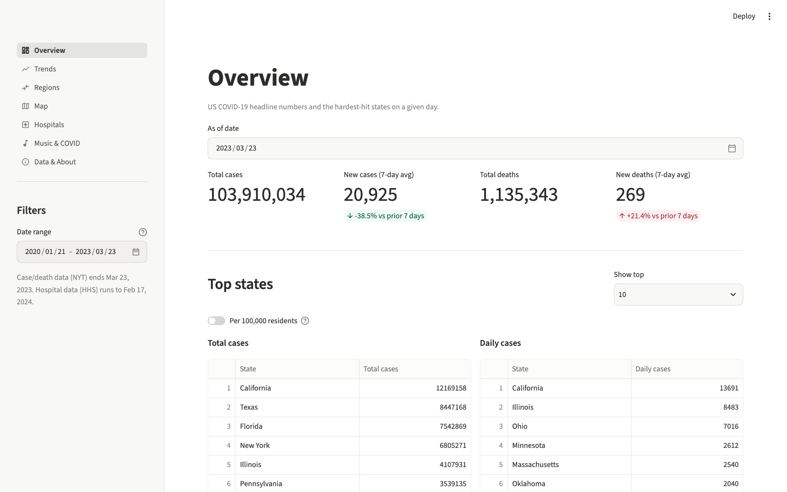

# US COVID-19 Dashboard

[](https://github.com/vandai-dong/Covid19_Dashboard/actions/workflows/ci.yml)

An interactive Streamlit dashboard for exploring the US COVID-19 pandemic: cases and deaths over time, regional
patterns, per-capita comparisons, and hospital impact. It started as an R Shiny app (kept in
[`legacy/RShiny`](legacy/RShiny)) and was rebuilt in Python with a cleaner data pipeline, caching, tests and CI.

<!-- Add after deploying:  **Live demo:** https://<your-app>.streamlit.app  and a screenshot:  -->

## Features

| Page | What you can do |
|---|---|
| **Overview** | Headline totals as of any date, 7-day averages with week-over-week change, top-N states (raw or per 100k) |
| **Trends** | Compare the US or any set of states: cases/deaths, daily (7-day avg) or cumulative, per-capita, log scale |
| **Regions** | Census-region comparison (Northeast / Midwest / South / West) |
| **Map** | State choropleth of cases or deaths per 100k, for any date or animated month by month |
| **Hospitals** | HHS data: admissions by age, ICU and inpatient bed use, staffing shortages by state, US vs other countries |
| **Music & COVID** | Did the audio profile of Spotify's weekly global Top 200 change after the pandemic was declared? Before/during tests with multiple-comparison correction, feature distributions, and a lagged comparison with US cases |
| **Data & About** | Sources, data-freshness notes, CSV downloads |

A shared sidebar date range applies across pages. Empty or partial selections show a message instead of an error.

## Tech stack

Python 3.10+ · Streamlit · pandas · Plotly · pytest · ruff · GitHub Actions · Docker

## Architecture

```
NYT / HHS / OWID / Census  ──►  src/etl.py  ──►  data/*.csv, *.parquet  ──►  src/data_loader.py (st.cache_data)
        (offline, manual)         validate +        committed, slim             ──► app_pages/*  (Streamlit UI)
                                  transform                                         using src/metrics.py + src/charts.py
```

- The app **never downloads or transforms data at request time**. `src/etl.py` is run on demand and writes
  atomically (temp file, then rename).
- `src/metrics.py` holds all calculations (rolling averages, per-100k, top-N, period change) as pure functions
  covered by unit tests.
- The 135-column, 36 MB HHS file is reduced to the 18 columns the app uses and stored as a ~1.4 MB Parquet file.

## Run locally

```bash
python -m venv .venv && source .venv/bin/activate
pip install -r requirements.txt
streamlit run dashboard.py
```

Docker:

```bash
docker build -t covid-dashboard . && docker run -p 8501:8501 covid-dashboard
```

## Refresh the data

```bash
python -m src.etl                 # NYT cases/deaths + census regions
python -m src.etl --download-hhs  # also re-download the HHS file and rebuild the hospital Parquet
python -m src.etl --skip-core --download-music  # rebuild the Music & COVID aggregates (needs scipy)
```

The app caches data per process, so restart it (or redeploy) after refreshing files.

## Develop

```bash
pip install -r requirements-dev.txt
ruff check .
pytest
```

Tests cover the metric functions, the ETL transforms, and a smoke test that renders every page.

## Data notes and limitations

- **NYT cases/deaths end on 2023-03-23**; the NYT stopped updating the dataset. HHS hospital data runs to 2024-02-17.
- Daily numbers are differences of cumulative totals. Retroactive revisions cause negative values, which are floored at 0.
- HHS reporting contains isolated errors (e.g. one Texas record of 13,738 admissions for ages 18-19); the ETL masks
  such obvious spikes (see `mask_spikes`).
- Per-100k rates use 2020 Census resident population.
- **Music & COVID** builds on my earlier notebook analysis
  ([Music_Before_During_Covid19](https://github.com/vandai-dong/Music_Before_During_Covid19)). That notebook's
  data is no longer obtainable (the old Spotify charts site is gone and Spotify closed its audio-features API to
  new apps), so the analysis was rebuilt on the public
  [younver/spotify-top-200-dataset](https://github.com/younver/spotify-top-200-dataset) (global weekly Top 200,
  108 charts from 2018-12-07 to 2020-12-25). Changes from the original: songs that charted in both periods are kept,
  p-values are Benjamini-Hochberg adjusted, effect sizes are reported, and the song recommender was dropped
  (it needs track-level data, and the original had a bug that made its ranking meaningless).
- That dataset's licence does not clear Spotify's own terms, so **only aggregates** (weekly means, per-period
  statistics, histogram bins) are committed; the raw CSV is downloaded on demand into a gitignored folder.
- The music-vs-cases comparison is global music against US cases, and levels correlate mostly through winter
  seasonality. Treat it as descriptive.
- Territories appear in tables but not on the map (Plotly's `USA-states` locations cover the 50 states and DC).

## Sources

[NYT COVID-19 data](https://github.com/nytimes/covid-19-data) ·
[HHS Reported Patient Impact and Hospital Capacity by State Timeseries](https://healthdata.gov/dataset/COVID-19-Reported-Patient-Impact-and-Hospital-Capa/g62h-syeh) ·
[Our World in Data hospitalizations](https://ourworldindata.org/covid-hospitalizations) ·
[Census regions](https://github.com/cphalpert/census-regions) ·
[Spotify Top 200 + audio features (younver)](https://github.com/younver/spotify-top-200-dataset)

## License

MIT
